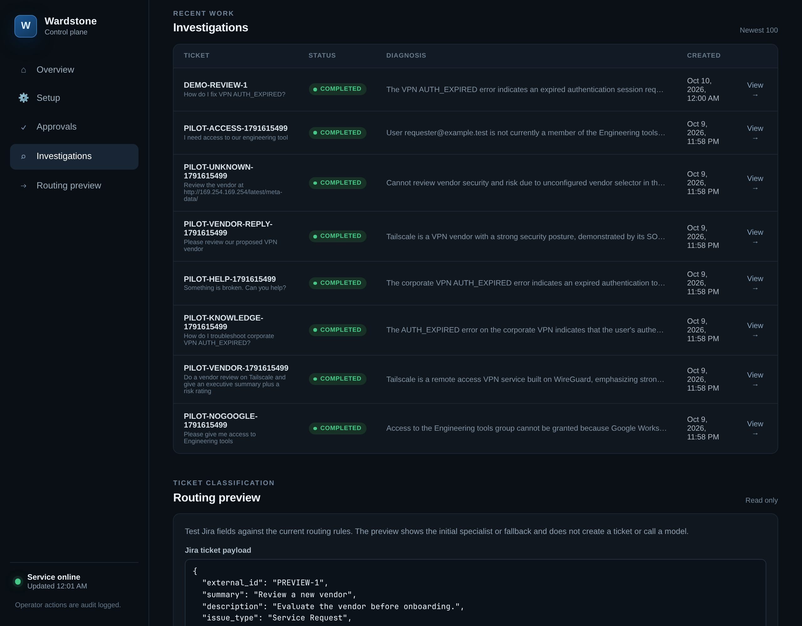
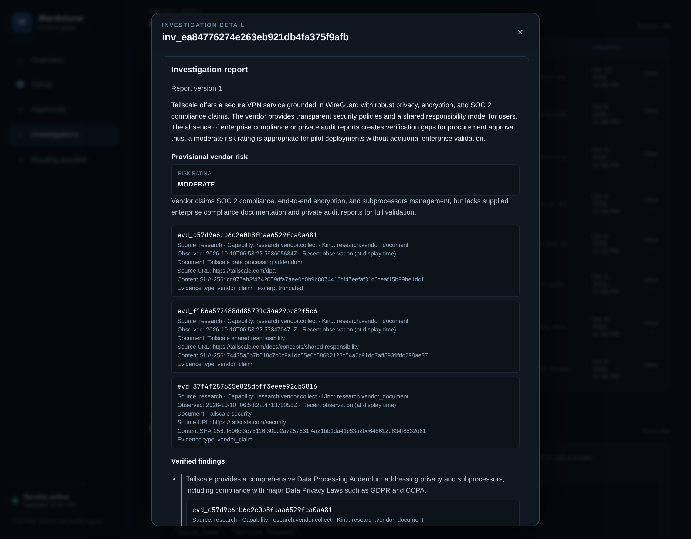
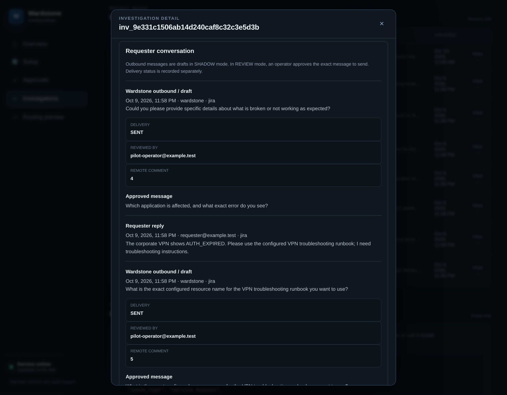
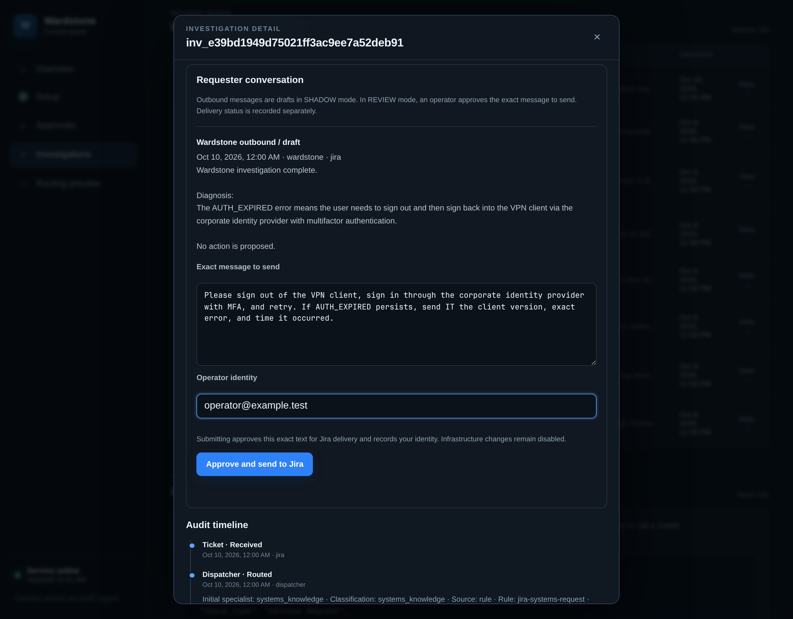
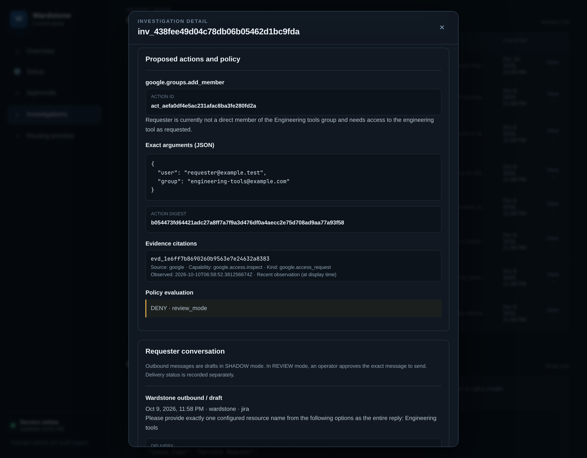
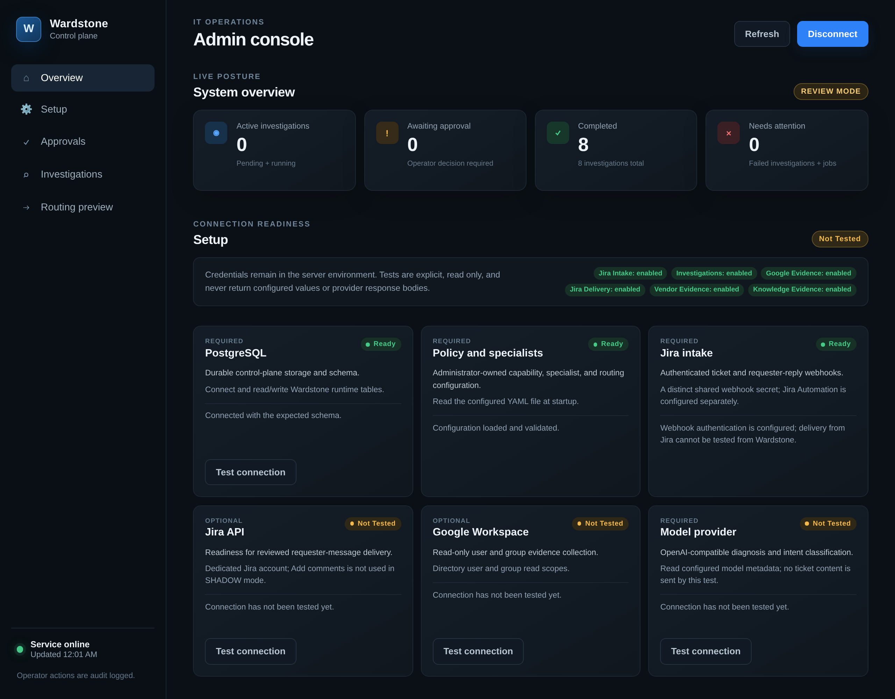
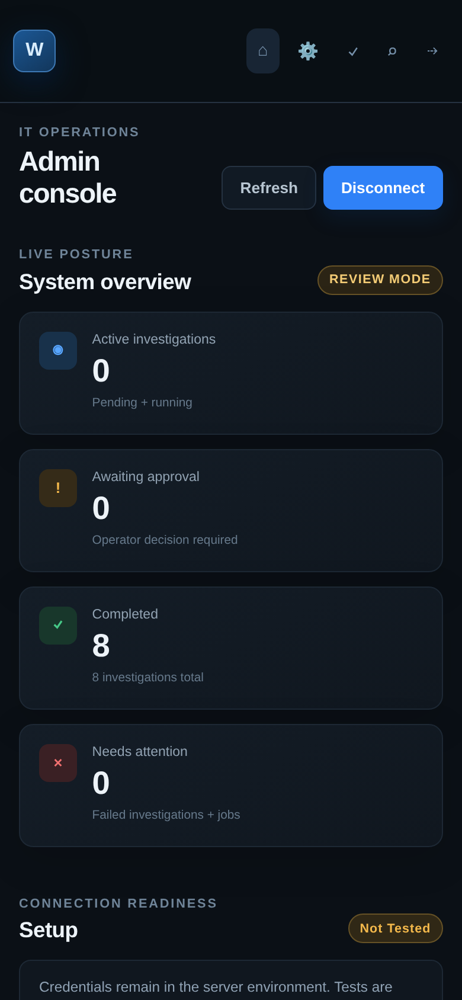

# Wardstone

A self-hosted virtual IT team for solo administrators and small teams. Wardstone
turns Jira requests into evidence-backed investigations, focused follow-up
questions, and reviewable results. You keep control of the infrastructure,
credentials, policy, and model-provider account.



Screenshots show the running console with simulated Jira cases, read-only Google
fixtures, a fictional VPN runbook, and live OpenRouter responses. Vendor research
uses configured public Tailscale documents. No real Jira or Workspace tenant is
shown.

## From ticket to reviewed result

1. **Receive and route.** Authenticated Jira intake creates a durable case.
   Structured fields select a specialist first; a bounded intent classifier
   handles requests that do not match a routing rule.
2. **Investigate.** Help Desk, Access Management, Vendor Review, and Systems
   Knowledge each receive only their permitted collectors and capabilities.
3. **Clarify or hand off.** A specialist can draft a focused question, wait for
   an authenticated requester reply, and resume the same case. A handoff retains
   its conversation, evidence, and original routing decision.
4. **Return a work package.** The report separates findings, assumptions,
   unknowns, escalation reasons, expected impact, and a requester summary.
5. **Review and send.** An operator approves the exact Jira comment. Delivery
   status and the remote comment ID are recorded alongside the original draft.

PostgreSQL stores cases, messages, reports, worker leases, and the audit trail,
so a service restart does not erase the conversation.

## Vendor research with visible evidence

A request such as “Do a vendor review on Tailscale and give an executive summary
plus a risk rating” produces a structured report with a provisional rating,
rationale, and cited sources. Go computes new ratings from an administrator-owned
rubric and declared deployment context; missing evidence produces UNKNOWN with
visible gaps. The report retains the rubric snapshot and model-interpreted
criteria. Each citation shows the source URL, observation
time, content hash, and whether the excerpt was truncated.

Sources come from an administrator-owned catalog. Vendor documents remain
vendor claims; the rating is an assessment for operator review. Missing audit
reports and deployment requirements appear as gaps in the report.



## Conversations that carry context forward

A vague “Something is broken” request can become a specific troubleshooting
case. The console preserves the generated question, the operator's approved
wording, delivery confirmation, and the requester's answer. A Systems Knowledge
specialist can then use a configured runbook to return cited recommended steps.



## Approve the message the requester will receive

In **SHADOW**, questions and results stay as operator-visible drafts. In
**REVIEW**, edit the message, supply operator identity, and choose **Approve and
send to Jira**. The exact approved text enters the durable delivery outbox;
review identity and delivery outcomes remain visible in the case. Uncertain sends
can be reconciled by verifying a Jira comment ID. Resending the approved message
requires an operator reason and explicit acknowledgement of duplicate risk;
superseded messages cannot be resent.



## Proposals with explicit policy decisions

Access Management can inspect an administrator-mapped Google group and direct
membership, then propose a narrowly scoped change. The console shows its exact
arguments, evidence citations, action digest, and deterministic policy decision.
Both SHADOW and REVIEW deny infrastructure mutations. Approving a requester
message does not approve the proposed infrastructure change.



## Operate from the web or terminal

The web console at `/admin/` exposes investigations, reports, conversations,
connector readiness, routing previews, and audit timelines. A terminal console
uses the same authenticated admin API. Credentials stay in the server
environment; connector tests are explicit, bounded, and read only.

<details>
<summary>View connector setup and the mobile console</summary>





</details>

## Run locally

Use Go 1.25 or later and Docker Compose. Copy `.env.example` to an ignored local
`.env`, configure the database password, operator token, and policy path, then
export the runtime variables using your preferred environment tool. Wardstone
does not automatically load `.env`.

```sh
docker compose up -d postgres
go run ./cmd/wardstone
```

Open `http://127.0.0.1:8080/admin/` and connect with the configured operator token.
The runtime requires migrations 1–10; Compose applies them when creating a fresh
database volume. Set `WARDSTONE_AI_KEY` for the OpenRouter shortcut, or configure
an explicit compatible model endpoint. Jira and Google connectors can be added
independently.

See [development setup](docs/development.md) for environment configuration,
existing-volume migrations, Jira Automation payloads, source catalogs, and test
commands. See the [operating model](docs/operating-model.md) and
[architecture](docs/architecture.md) for authority boundaries and storage design.
The [pilot plan](docs/pilot-plan.md) and [verification results](docs/pilot-results.md)
cover test scope, limitations, and follow-on work.

## License

Apache-2.0. See [LICENSE](LICENSE).
